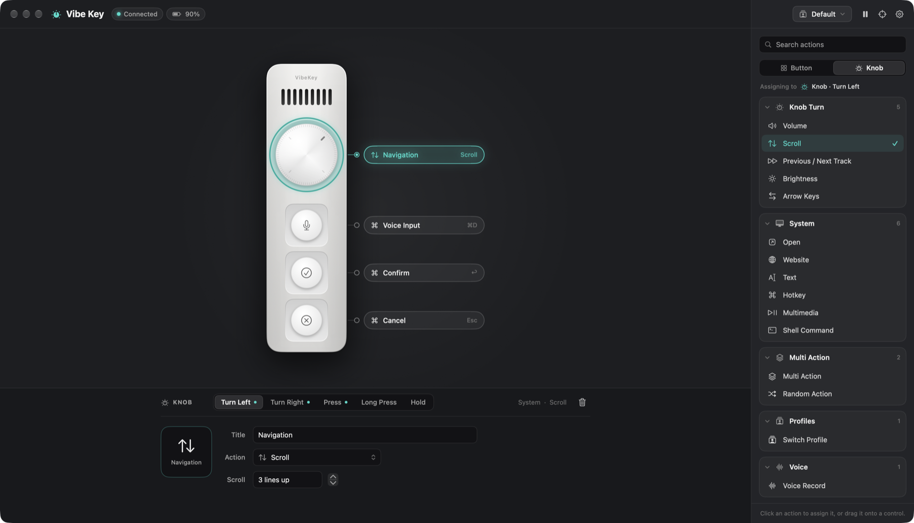

# vibekey-mac

A native macOS replacement for Ulanzi Studio for the **Ulanzi AU05 "Vibe Key"**. It's a menu bar app with a visual editor, plus a CLI.



Everything stays local: no network calls, no telemetry, no accounts, and no talking to Ulanzi's servers. Nothing is flashed or saved to the device. The only thing Vibe Key sends it is the same "host online" heartbeat Ulanzi Studio sends (see [How it talks to the AU05](#how-it-talks-to-the-au05)).

## Build

Requires macOS 14+ and the Xcode Command Line Tools. The full Xcode IDE isn't needed.

```bash
swift build                       # debug build of everything
.build/debug/vibekey-cli help     # CLI, usable right away
scripts/bundle.sh                 # release build -> build/VibeKey.app (ad-hoc signed)
cp -R build/VibeKey.app /Applications/
```

The bundle also contains the CLI at `VibeKey.app/Contents/MacOS/vibekey-cli`.
To sign with a real identity, set `SIGN_IDENTITY="Apple Development: …"`. This keeps permissions stable across rebuilds (see below).

## CLI

| Command | What it does |
|---|---|
| `vibekey-cli test` | Guided check: asks for each control in turn and confirms it arrives. Start here when something doesn't work. |
| `vibekey-cli monitor` | Live, decoded view of everything the device sends (keys, battery, status), also written to `monitor.log`. |
| `vibekey-cli listen` | Prints decoded events (`micPress`, `knobRight`, …) and gestures (`mic.tap`, `mic.holdStart`, …). |
| `vibekey-cli run` | Headless mode: performs the configured actions without the UI. |
| `vibekey-cli calibrate` | Remaps the controls and writes `layout.json`. Only needed if a firmware update reorders them. |
| `vibekey-cli raw` | Every vendor report, encrypted and decrypted. |
| `vibekey-cli selftest` | Checks the protocol codec against frames captured from a real unit. No device needed. |
| `vibekey-cli paths` | Shows where the config files live. |

Quit Ulanzi Studio before using Vibe Key or the CLI. Both would compete for the device.

## How it talks to the AU05

The vendor interface (usage page `0xFFFC`, report `0x55`) carries 64-byte frames encrypted with TEA under a fixed key shared by every unit. This matches the independent write-ups in [arumwu/vibekey-lite](https://github.com/arumwu/vibekey-lite) and [MrCroxx/olanzi](https://github.com/MrCroxx/olanzi). The repeating "filler" seen on the wire is just an encrypted all-zero block. Vibe Key decrypts each frame. A key event reads `8b 10 <action> <down/up> <control index>`, and the receiver also reports battery level.

The device only sends key events while a host keeps it in **host mode**. While connected, Vibe Key sends the same heartbeat Ulanzi Studio does, about once per second. While it does, the firmware stops typing its own stored shortcuts, so there's no double ⌃D. When Vibe Key quits, it tells the device to go back to its own shortcuts. The firmware also falls back by itself if the heartbeat stops.

## Test and calibration

Controls are identified by the protocol, so no calibration is needed. If something seems off, run `vibekey-cli test`, or use the **scope** icon in the app.

Test & calibrate asks for each control in turn and saves which control reported which index to `~/Library/Application Support/vibekey-mac/layout.json`. That only matters if a firmware update ever reorders the controls. **Reset** in Settings › Device goes back to the standard layout.

## Permissions

| Permission | Needed for | Why |
|---|---|---|
| *(none)* | Reading the buttons and knob | The vendor HID interface (usage page `0xFFFC`) needs no special permission. |
| **Accessibility** | Hotkeys, typing text, media keys, scrolling | These are synthesized with `CGEvent`. The app prompts on first launch. Grant it in System Settings › Privacy & Security › Accessibility. |
| **Microphone** | Only the *Voice Record* action | Records from the AU05 input, selected by name. The system default input is never changed. |

With an ad-hoc signature, every rebuild counts as a "new" app to macOS. If a permission stops working after a rebuild, remove the old entry in System Settings and grant it again. Signing with a stable identity avoids this.

## Configuration

`~/Library/Application Support/vibekey-mac/config.json` is human-readable and reloads automatically when you edit it. If you save invalid JSON, the change is ignored and the app keeps running on the last good config.

- **Profiles:** switch them from the top bar, the menu bar, or a *Switch Profile* action.
- **Slots per control:** Press (`tap`), Long Press (`longPress`), Hold (`hold`). The knob also has Turn Left / Turn Right (`left` / `right`).
  - If a control has a **Hold** action, a hotkey stays held down while you hold the button (push-to-talk), and Voice Record records while held.
  - With a **Long Press** action set, Press fires on release. Without one, it fires the moment you press.
- **Action types:** `hotkey` (`"keys": "ctrl+shift+d"`), `text`, `open` (app name or path), `website`, `shell`, `media` (`volumeUp`, `volumeDown`, `mute`, `playPause`, `next`, `previous`, `brightnessUp`, `brightnessDown`), `scroll` (`amount`, positive = up), `multi` (`actions` + `delay`), `random`, `switchProfile`, `voice`.

```json
"mic": { "title": "Dictate", "hold": { "type": "voice" } },
"knob": { "title": "Navigation",
          "left":  { "type": "media", "media": "volumeDown" },
          "right": { "type": "media", "media": "volumeUp" },
          "tap":   { "type": "media", "media": "mute" } }
```

### Voice capture → local transcription

Under Settings › Voice capture, set a command such as:

```
whisper-cli -m ~/models/ggml-base.en.bin -nt -np -f {file}
```

and enable "Type the command's output". Recordings are saved as 16 kHz mono WAV files.

## Layout

- `Sources/VibeKeyCore`: HID watcher (handles unplug and replug), calibration, config store with hot reload, gestures, action runner, voice recorder.
- `Sources/vibekey-cli`: the command-line tool.
- `Sources/VibeKey`: the SwiftUI menu bar app and editor.
- `Resources/AppIcon.icns`: the app icon, generated by `swift scripts/make-icon.swift`.

## Development

To review the UI without Screen Recording permission, run the app in snapshot mode. It walks the editor through its main states, saves a PNG of each window, and quits. It never opens the device or writes `config.json`.

```bash
VIBEKEY_SNAPSHOT_DIR=/tmp/vibekey-shots build/VibeKey.app/Contents/MacOS/VibeKey
```
